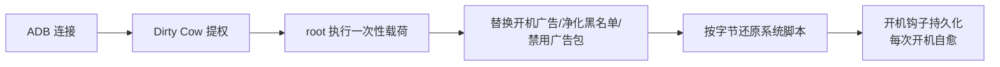

<div align="center">

# 📺 letv-tv-ad-free

**乐视超级电视 去广告 · 精简 · 解锁安装 — 完整作战手册**

[](https://github.com/clrs520/letv-tv-ad-free/stargazers)
[](LICENSE)
[](#-支持机型)
[](#-支持机型)
[](#-它是怎么工作的)
[](#-参与贡献)

**无需 Root · 不刷机 · 不碰 /system · 全程可逆**
**No root · No firmware flash · No /system writes · Fully reversible**

*Remove boot ads, bloatware & the sideload install-lock from LeTV EUI (Mstar) Android TVs*

</div>

---

还记得吗？每次打开电视，先看 **15 秒不能跳过的开机广告**；信号源页面塞满
「霸屏榜单」「热门推荐」；装个第三方应用弹出 **「存在安全隐患，已禁止安装」**。

这台 2019 年的电视以为它还能这样过下去——直到被一台电脑 + 一根网线
用 2005 年的 Linux 内核漏洞彻底改造成了纯净机。

## ✨ 项目亮点

- 🚫 **开机广告 15 秒 → 0.44 秒**（替换成电视自带的 logo + 开机音乐）
- 🔓 **破解应用安装锁**——反编译出整个判决链，黑名单里 67 个应用（当贝/沙发管家等）全部解封
- 🧹 **五大广告面全灭**：开机 / 信号源推荐 / 关机 / 屏保 / App 开屏
- 🛰️ **遥测上报拦截**：秒针、AdMaster、Nielsen 等 14 个追踪域名
- 🪝 **持久化自愈**：开机钩子 + 每 10 分钟看门狗，云端重推广告也会被自动洗掉
- 📖 **完整逆向笔记**：广告架构图、安装锁判决链、12 条血泪 Scar 表——**包括我们
  自己踩过的最大那次坑**（改坏 packages.xml 变砖 + 官方固件救回全过程）
- ♻️ **可逆**：所有改动可一条命令还原

## 📊 实测效果（超4 X4-50 全链路验证）

| 项目 | 之前 | 之后 |
|---|---|---|
| 开机广告 | 15 秒（按日轮播，不可跳过） | **0.44 秒** logo 片 |
| 开机推广页 | 「客厅杂志」，需按一次 OK | **自动消失**（出厂调试开关） |
| 信号源页 | 霸屏榜单 + 热门推荐 | 正常切换，广告内容断供 |
| 关机/屏保/开屏广告 | 有 | 全部清理 + 自愈 |
| 遥测上报 | 14 个追踪域名 | 全部拦截 |
| 第三方安装 | 「存在安全隐患，已禁止安装」 | **正常安装**（当贝市场可用） |
| 后台预装 | 游戏/卡拉OK/商店等常驻 | 38 项禁用（可逆） |

## 🔧 它是怎么工作的（一句话版）

旧内核有 Dirty Cow（**CVE-2016-5195**，2.6.22–4.8 都中招），而乐视自己留了一个
以 root 身份执行脚本的 init 触发器。用 Cow 改写那个脚本 → 以 root 完成全部改造
→ 再把脚本按字节还原。所有持久化都落在 `/data` 分区和乐视自带的开机钩子里，
**`/system` 一个字节都没动**（动了会立刻触发保护性重启——这是实测特性）。



## 📦 仓库内容

```
SKILL.md                    ⭐ agent 可执行的完整作业手册（核心，Phase 0-7 + Scar 表）
scripts/dirtycow.c          freestanding aarch64 Dirty Cow（两线程竞态 + 校验循环）
scripts/build_exploit.sh    NDK 编译 + 推送（-nostdlib，原因见 Scar 表）
scripts/make_short_clip.sh  电视自带 logo+开机音乐 → 替换片（ffmpeg）
scripts/sanitize_tvmaster.py  安装黑名单库净化（token-safe，防 11:1 误伤）
scripts/setup_launcher.sh   第三方桌面备份/安装
scripts/tvfix.template.sh   开机钩子模板（八段式，每段有注释）
puresource/                 纯净信号源 app（存档：可用，但我们最终回归原生信号源页）
docs/NOTES.md               逆向笔记：广告架构 / 判决链 / 关键路径 / 工具链
```

## 🚀 快速开始

```bash
# 0) 前提：电视已开 ADB（设置→关于→连按多次版本号开通），电脑装好 adb 与 NDK
adb connect <TV_IP>:5555

# 1) 编译提权工具并推送
scripts/build_exploit.sh <TV_IP>:5555

# 2) 按 SKILL.md 的 Phase 0-7 走
#    定位广告机制 → Cow 提权 → 替换开机视频 → 部署开机钩子 → 清理与解锁
```

详细步骤、每一步的验证方法和全部已知陷阱都在 **[SKILL.md](SKILL.md)**。

## 📱 支持机型

| 状态 | 机型 |
|---|---|
| ✅ 全链路实测 | **超4 X50（X4-50）**，EUI V2401RCN02C080080B04121S |
| 🧪 理论适用 | 超4 系列 X40/X43/X43Pro/X50Pro/X55（同为 Mstar 6A938 平台） |
| 🔍 方法论可迁移 | 超3 系列（918/928 平台，需按 SKILL.md 重新定位触发器与路径） |

> SKILL.md 教的是**定位方法**（怎么找到你机器上的提权触发器和广告机制），
> 而不是乐视专属参数的照抄——换型号也能按图索骥。

## ❓ FAQ

**Q：会变砖吗？**
A：本项目所有操作只写 `/data` 分区，`/system` 全程只读。我们实测中最严重的一次
事故是改坏了系统配置文件（packages.xml），完整事故过程 + 官方固件救回全过程
都写进了 Scar 表——这也是为什么文档里把它标成绝对禁区。

**Q：真的不需要 Root？**
A：不需要。利用的是旧内核的 Dirty Cow 漏洞临时提权，不需要解锁、不需要刷机、
不安装任何常驻 root 管理。

**Q：我的开机广告是 15 秒且跳不掉，能去掉吗？**
A：能，而且不用删——直接删有黑屏风险（实测），正确做法是替换成 0.44 秒的
合法短片，播放管线照常走完。

**Q：乐视服务器不是倒闭了吗，为什么还有广告？**
A：广告投放 CDN 还活着（我们实测抓到过凌晨下发的轮播广告）。所以项目里做了
「自愈」：云端重推的广告，开机 10 分钟内会被自动替换掉。

**Q：升级系统会失效吗？**
A：OTA 会还原全部改动，重跑一遍流程即可（工具都在，30 分钟内完成）。钩子里
已默认禁用系统升级应用防止自动 OTA。

## ⚠️ 免责与边界

- 仅用于**你自己拥有**的设备；操作有变砖风险，后果自负。
- 会去掉厂商的广告与远程管控能力，属个性化改装；请遵守当地法律，勿用于
  盗版内容分发。
- `/system` 分区全程只读。任何试图重挂载 /system 的操作在这类电视上会触发
  保护性重启——这是特性不是 bug，别试。
- 我们不是第一个做乐视去广告的项目，但可能是把**坑踩得最全、文档写得最诚实**
  的那个——包括自己搞变砖又救回来的那一次。

## ⭐ 参与贡献

- 如果这个项目帮到了你的老电视，**点个 Star** 让更多乐视用户看到
- 在其他型号上跑通了（或跑挂了）？开 Issue 告诉我们型号和现象，补充支持矩阵
- 新的 Scar（坑）尤其受欢迎——这个项目的核心价值就是避坑清单

## License

[MIT](LICENSE)
